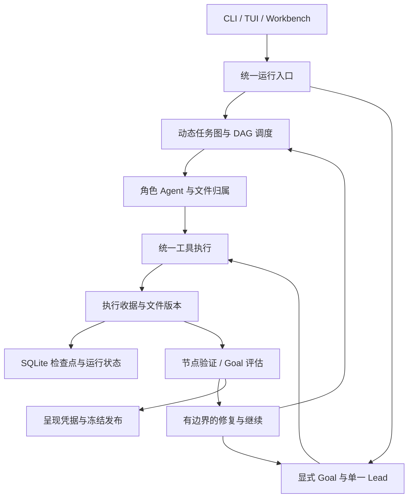

# 🌌 天枢 · AstralNexus

**让复杂任务有明确的分工、可追踪的执行和有依据的恢复。**

[](setup.py)
[](tui/package.json)
[](docs/status.md)
[](LICENSE)

[快速开始](#快速开始) · [核心能力](#核心能力) · [架构](#架构) · [验证进展](#验证进展) · [文档](#文档)

AstralNexus 是面向长程复杂任务的 AI 多智能体编排框架。它将自然语言任务转化为动态任务图，协调 Agent、工具和工作区，并通过持久化状态、执行收据和文件版本管理失败恢复与交付。

你可以通过终端客户端或本地网页与天枢对话，查看工具调用和任务进度，选择主模型与子模型，并控制工具审批。框架支持 OpenAI-compatible Chat Completions 接口，当前默认模型为 **DeepSeek V4.1 Flash**。

> [!NOTE]
> 项目处于 Alpha 阶段。已有从原始输入自主开发全栈项目、执行 HTTP 测试并发布本地交付版本的实跑记录。浏览器完整交互验收仍待独立验证；单次成功不代表所有复杂任务都能稳定完成。

## 快速开始

### 1. 获取项目

```bash
git clone https://github.com/brokenchapt3r/AstralNexus.git
cd AstralNexus
```

Python 核心要求 **Python 3.11+**；构建 TUI 建议使用 **Node.js 22+**。

### 2. 安装

在仓库根目录创建并激活 Python 虚拟环境：

```powershell
python -m venv .venv
.\.venv\Scripts\Activate.ps1
```

macOS / Linux 使用 `source .venv/bin/activate`。

构建终端客户端，然后安装 Python 核心：

```bash
cd tui
npm ci
npm run build:ink
npm run build
cd ..
python -m pip install -e ".[dev]"
```

### 3. 配置模型

以下配置使用百炼的 OpenAI-compatible 接口。请使用能够访问所选模型的密钥：

```powershell
$env:ASTRALNEXUS_API_KEY = "your-key"
$env:ASTRALNEXUS_BASE_URL = "https://dashscope.aliyuncs.com/compatible-mode/v1"
$env:ASTRALNEXUS_MODEL = "deepseek-v4.1-flash"
$env:ASTRALNEXUS_SUB_MODEL = "deepseek-v4.1-flash"
$env:ASTRALNEXUS_HOME = Join-Path $PWD ".astralnexus"
```

macOS / Linux 可用 `export NAME=value` 设置同名环境变量。其他兼容服务可替换接口地址和模型 ID。密钥通过环境变量加载，`config.yaml` 提供模型配置示例。

### 4. 开始使用

**终端客户端**

```bash
astralnexus --tui
```

**本地网页工作台**

```bash
astralnexus-workbench --home ./.astralnexus/host --port 5073
```

打开 <http://127.0.0.1:5073>，创建会话并选择工作区。可以在设置中选择主模型、子模型和插件，在对话输入区选择工具审批模式。

**任务文件执行**

```bash
astralnexus run --task examples/tasks/software_fix.md --output ./runs
```

**持续目标**

在对话中输入：

```text
/goal 按工作区中的需求完成开发，执行测试并交付结果。未通过的检查应保留真实失败证据。
```

显式 Goal 会在回合结束后独立评估可见执行证据，并在条件允许时继续工作。保护停机、证据不可获取或需要用户处理时会停止。

## 核心能力

### 动态任务图与多 Agent 协作

TaskGraph 表达任务节点、依赖和产物关系。Governor 负责准入与图补丁校验，调度器按就绪波次执行任务。文件写入归属和依赖关系为并行协作提供执行边界。

任务图模式和显式 Goal 模式使用不同的执行策略：前者围绕 DAG 调度，后者由单一 Lead 执行工具回合并接受回合后的目标评估。

### 工具、Skills 与插件

统一工具注册与调用接口连接文件操作、命令执行、测试、HTTP、浏览器、SQLite、LSP、MCP 和技能系统。技能提供可复用工作方法，插件按宿主及会话配置启用。

工具是否可用取决于本地依赖和服务配置。技能目录中的资源数量不等于完成适配的插件数量。内置能力与限制见[能力状态表](docs/status.md)。

### 上下文与执行证据

SQLite 检查点保存运行状态。工具收据记录调用、结果、退出码和文件版本，当前执行状态与 Goal 交接分别保留不同工具通道的证据，减少后续调查覆盖真实测试结果的问题。

进展判断区分追溯身份与内容变化：同一结果换一个执行 ID，不会因此获得新的进展信用。

### 失败恢复与预算控制

框架支持中断、检查点恢复和受治理的修复调度。执行预算与停滞检测限制重复调用和持续空转；直接 Goal 的滚动写入检测会在长期没有新修改时提醒并收回工具。

失败证据保留供后续复验。保护停机不会被当成成功，也不自动绕过守卫重新启动同一任务。

### 终端与网页工作台

React + Ink TUI 提供流式对话、工具展开、任务状态和交互审批；本地 Workbench 提供会话、模型、插件、运行观察与控制入口。

工具授权支持请求批准、帮我批准和完全访问模式。具体边界由宿主策略决定。网页接口目前属于本地内部接口，尚未承诺稳定的公共 API。

### 可追踪的交付

默认交付根据本轮输出差异与 `present_files` 的呈现匹配生成唯一 `run.delivery` 凭据。发布器绑定文件快照与运行所有权，冻结版本保存在 `deliverables/vN/`。

**输出已呈现、Goal 已满足和独立业务验收通过，分别表达不同范围的结论。** 默认交付凭据证明文件交给用户，业务正确性仍需真实测试与验收证据。

## 架构



主要职责分布：

| 模块 | 职责 |
| --- | --- |
| `core/` | 任务图、Governor、编排、验证与交付 |
| `runtime/` | 模型客户端、上下文、执行收据、预算和会话 |
| `tools/` | 工具注册、执行、审批、MCP 与技能适配 |
| `storage/` | SQLite 持久化与恢复读取 |
| `dashboard/`、`tui_gateway/` | 网页宿主与终端客户端后端 |

## 验证进展

最新自主案例使用空产品工作区，仅提供原始任务书与合成数据，由天枢自行完成设备维修工单平台开发。

已经观察到的闭环包括：后端与前端生成、数据库初始化、角色权限与工单状态流、真实 HTTP 测试、失败定位与代码修复、重启持久化验证、七类文档和本地版本发布。最后一次项目测试为 **45 passed，退出码 0**。

尚未完成独立的真实浏览器交互验收，因此该案例证明的是自主开发、HTTP 测试与本地发布链路。完整案例口径见[实跑记录](docs/validation/fullstack.md)。

框架近期对证据交接、停滞控制和模型调用进行了离线回归；这些测试验证框架机制，不替代生成项目的业务测试。

## 仓库结构

```text
AstralNexus/
├── src/AstralNexus/     # Python 引擎与随包分发的工具、技能和资源
├── tests/              # 框架测试与离线回放夹具
├── docs/               # 用户、架构、开发和验证记录
├── examples/           # 示例任务
├── scripts/            # 开发、检查与清理脚本
├── tui/                # React + Ink 终端客户端
├── pyproject.toml      # Python 构建与测试配置
├── setup.py            # 包元数据、依赖与入口
└── README.md
```

## 文档

- [核心引擎说明](docs/core.md)
- [能力状态与限制](docs/status.md)
- [用户手册](docs/user_manual.md)
- [架构说明](docs/architecture.md)
- [开发指南](docs/development.md)
- [TUI 开发说明](tui/README.md)
- [自主全栈实跑记录](docs/validation/fullstack.md)

## 开发与贡献

欢迎提交可复现问题、回归测试和能力适配。Python 修改应先执行编译或 import 检查，再运行相关 pytest；工具和模型测试应明确外部依赖及调用成本。

```bash
python -m compileall -q src/AstralNexus
python -m pytest tests/test_presentation_delivery_policy.py tests/test_write_progress_guard.py -q
```

完整离线测试使用 `python -m pytest tests -m "not live_llm"`。安装 `requirements-mypy.txt` 后，可运行 `python scripts/check_mypy.py` 检查类型。清理生成文件前可用 `python scripts/clean.py --dry-run` 查看范围。

TUI 验证：

```bash
cd tui
npm run check
npm run build
```

模型密钥、本地数据库和个人运行日志请保留在本地，不提交到仓库。

## 许可证与致谢

仓库顶层许可见 [LICENSE](LICENSE)（Apache-2.0）；Python 核心保留其 [MIT 许可](src/AstralNexus/LICENSE)。TUI 中 Hermes 衍生组件的许可见 [HERMES_TUI_LICENSE](HERMES_TUI_LICENSE)，第三方技能遵循各自目录中的许可。

项目在开发中参考了 DeerFlow、DeepSeek Harness 和 Hermes 的工程实践，保留所使用第三方组件的来源与许可。感谢这些开源项目。
